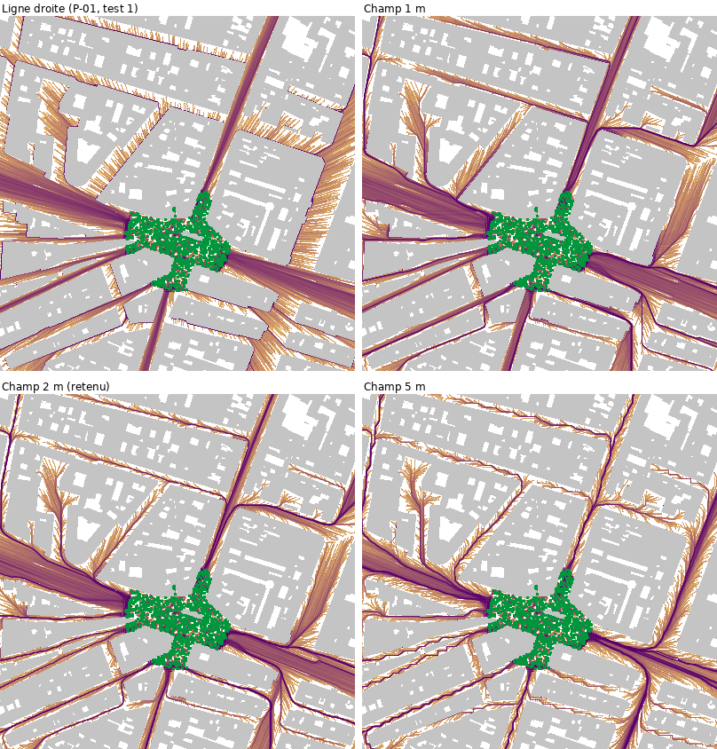

# P-03 — Flow fields

Prototype jetable. Problèmes : [A-01](https://github.com/labatailledefrance/documentation/blob/main/OPEN-PROBLEMS.md#a-01--nombre-de-zombies--simulation-par-tiles), [A-05](https://github.com/labatailledefrance/documentation/blob/main/OPEN-PROBLEMS.md#a-05--entassement-et-franchissement-dobstacles), [A-07](https://github.com/labatailledefrance/documentation/blob/main/OPEN-PROBLEMS.md#a-07--recherche-de-chemin). Fiche du prototype : [prototypes/README.md](../README.md#p-03--flow-fields). Points de départ : [P-02](../p02-perception/README.md), [P-01](../p01-tile-paris/README.md#test-2--relais-veille-et-emprises-réelles).

## Hypothèse testée

Dans P-01 et P-02, une horde ne sait aller que vers une cible fixe : chaque tile calcule une fois, à sa création, un champ de distance vers le centre du groupe d'humains. Ce champ ne suit ni une cible mobile, ni plusieurs stimuli, ni un obstacle qui apparaît. Ailleurs, les zombies vont en ligne droite et s'écrasent contre les immeubles.

Un **flow field** (champ de direction calculé pour toute une tile, que tous les zombies descendent) peut-il déplacer des hordes entières de façon crédible, avec des cibles mobiles et des obstacles qui apparaissent, dans le budget ? À quelle résolution, combien de champs par tile, à quelle fréquence de recalcul ?

Deuxième question, héritée de P-02 : la **grille des zombies** (cases de 2 m, séparation, capacité, relais) est le premier poste d'une tile calme (45 % du tick). Par quoi la remplacer ? Et que coûte la **réservation exacte des places** décidée en A-05 ?

## Machine

Machine de référence (F-02) : AMD Ryzen 7 5700X (8 cœurs, 16 threads), 32 Go de DDR4, Linux 7.0. Rust 1.99, `bevy_ecs` 0.20.1. Mesures du 2026-11-14.

## Méthode

### Point de départ

Le code de P-02 est copié dans [src/](src) (P-01 et P-02 ne sont pas modifiés), avec sa configuration retenue : arbre k-d des humains reconstruit à chaque tick, relais filtré, veille, veille profonde au-delà de la vue. Tiles réelles de `data/generated/p01-tiles/`, 20 000 zombies et 1 000 humains mobiles par tile, agents placés dans la plus grande zone de rues connexe. La vue est de **400 m** (décision de P-02 pour la ville), le seuil de veille profonde de 500 m.

### Les flow fields ([src/champ.rs](src/champ.rs))

Analogie : une table de routage à vecteur de distances, calculée d'un coup pour toute la tile. Chaque case connaît sa distance à pied à la source la plus proche ; un zombie suit la pente, comme un paquet suit son prochain saut. Le coût est payé une fois par tile, quel que soit le nombre de zombies qui le lisent.

- **Terrain** : la tile est découpée en cases de 1, 2, 4 ou 5 m. Une case grossière est franchissable si au moins la moitié de ses mètres carrés sont libres (règle « majorité ») ou si un seul l'est (règle « toute »). Coût d'entrée : 2 pour une rue, **3 pour une rue au contact d'un mur** (la **marge**, qui éloigne la foule des façades), 80 pour une barricade : franchissable par entassement (A-05), donc très chère mais pas interdite.
- **Calcul** : algorithme de Dial (Dijkstra à seaux), coûts 5 en ligne droite et 7 en diagonale (√2 à 1 % près), pas de coin de mur coupé en diagonale. Un masque d'arêtes précalculé par case évite de relire les coins.
- **Direction** : gradient lissé sur les 8 voisins plus proches de la source, pondérés par la pente (une infinité de directions, pas 8). Lu à la demande, environ 35 ns.
- **Combien de champs** : un par **type de stimulus**, à sources multiples, soit **deux par tile** :
  - « **proies** » : sources = les humains **observés** par au moins un zombie depuis moins d'une minute, à la position où ils ont été vus. Un zombie en poursuite, relayé ou qui a perdu la trace le descend. C'est exactement la règle de la dernière position connue : une source vit une minute après sa dernière observation, sans télépathie (un humain que personne n'a vu n'est pas une source) ;
  - « **bruits** » : sources = les bruits de la tile ; recalculé quand la liste change.
  
  Un champ par humain coûterait 1 000 fois plus ; un champ partagé mène chaque zombie à l'humain observé le plus proche à pied, ce qui est crédible. À moins de 15 m de sa cible, un zombie va droit sur elle.
- **Recalcul** des « proies » tous les N ticks, décalé d'une tile à l'autre. Option d'**étalement** : le calcul est interrompu et repris au tick suivant, avec un budget de cases par tick déduit du calcul précédent ; les zombies lisent l'ancien champ pendant que le nouveau se construit (double tampon). Analogie : un `VACUUM` incrémental plutôt qu'un verrou de table.
- **Obstacle qui apparaît** (barricade, effondrement) : **recalcul partiel** des cases dont le plus court chemin passait par l'obstacle (ses « descendants » dans l'arbre des plus courts chemins), puis propagation depuis leur bordure. Analogie : un retrait de route qui n'invalide que les préfixes appris par ce lien. Le résultat est identique au calcul complet (tests, et colonne `egal` du banc). Un obstacle détruit est traité par une propagation des baisses.
- **Frontières de tile** : chaque tile exporte ses cases de bord ; sa voisine les reprend comme graines dans un anneau de halo, au calcul suivant. C'est un protocole à vecteur de distances entre tiles. Chaque case porte l'**horodatage** de l'observation de sa source, comme l'alerte relayée de P-01 : une valeur relayée ne survit pas à sa source, ce qui évite le comptage à l'infini.

### L'index des zombies ([src/voisinage.rs](src/voisinage.rs))

Il sert à trois choses : la séparation (16 voisins au plus), la capacité par case, la recherche de relais (avec un bit d'alerte par case pour le filtre). Quatre structures interchangeables, qui rendent **exactement** les mêmes voisins dans le même ordre :

| Structure | Principe | Analogie |
|---|---|---|
| **Dense32** (P-01, P-02) | tableau « case → début » de 250 000 u32, plus un tableau de curseurs ; tri par dénombrement | une table d'allocation complète |
| **Dense16** | même tableau en u16 (20 000 zombies tiennent), sans curseurs : tri par dénombrement à rebours ; 4 fois moins d'octets | la même, compactée |
| **Triee** | zombies triés par case (tri par base en deux passes), répertoire des 500 lignes, dichotomie dans la ligne | un index trié avec table des matières |
| **Creuse** | table de hachage des seules cases occupées, entrées marquées par génération (jamais remise à zéro) | une table de hachage |

Plus une variante à **cases de 4 m** (Dense16), qui change le résultat (voisinages et capacité différents) : ses écarts sont mesurés.

### La réservation des places ([src/sim.rs](src/sim.rs), phase « admission »)

Un zombie qui veut entrer dans une case soumise à réservation ne bouge pas : il dépose une demande (case, priorité tirée d'un hachage, rang). Une phase par tile trie les demandes et admet, case par case, au plus *capacité − occupants au début du tick*. Les zombies qui sortent ne libèrent leur place qu'au tick suivant : la borne est exacte. Le tri rend le résultat indépendant de l'ordre d'écriture des threads, comme un journal de transactions rejoué dans l'ordre des horodatages. Trois modes :

- **aucune** : admission progressive partout (P-01, P-02) ;
- **contact** : réservation sur les cases au contact d'une barricade ou d'un humain (3 × 3 cases autour de chacun), admission progressive ailleurs (décision A-05) ;
- **partout** : réservation sur toutes les cases.

### Un tick, en six phases chronométrées

humains (déplacement, arbre k-d, carte de proximité) → **grilles** (index des zombies, cases au contact) → **champs** (obstacles nouveaux, recalculs dus) → perception → déplacement (descente du champ, séparation, murs, capacité) → **admission** (réservations). Chaque phase lit l'état de la précédente et n'écrit que l'entité ou la tile qu'elle traite.

### Scénarios

Ceux de P-01 (calme, dispersé, assaut), plus :

- **repli** : les 1 000 humains du groupe se replient à 3 m/s vers un point situé à environ 600 m de marche du centre, en colonne (ils descendent leur propre champ de marche) ;
- **barricade** : pendant l'assaut, un anneau de barricades de 2 m d'épaisseur, à 80 m du centre, barre toutes les rues sauf deux (les plus proches de l'est et de l'ouest). Posé au premier tick mesuré (*apparition*, pour le coût du recalcul), ou avant le préchauffage (*initiale*, pour la densité au contact d'un obstacle fixe).

L'assaut est mesuré après 120 s de jeu, les autres scénarios après 10 s.

### Crédibilité du mouvement ([src/observation.rs](src/observation.rs))

Mode observation, sur la tile la plus bâtie (61 %). Toutes les 10 s de jeu, contre un **oracle** (champ exact à 1 m, sans marge, vers ce que l'état du zombie lui fait suivre : sources du champ « proies », ou bruit) :

- **progression** : baisse moyenne de la distance à pied à la cible, en m/s (la course est à 5 m/s) ;
- **bloqués** : zombies qui ont progressé de moins de 2 m en 10 s et sont encore à plus de 20 m de leur cible. **Hors foule** : parmi eux, ceux dont la case de 2 m compte au plus 2 zombies, c'est-à-dire bloqués par le chemin (derrière un immeuble) et non par un bouchon ;
- **écart** : part des zombies guidés dont la direction donnée par le champ courant s'écarte de plus de 45° de celle d'un champ recalculé à l'instant (effet de la période de recalcul) ;
- **murs** : zombies dans un bâtiment (doit rester à 0) ; densités.

Et des **images** de densité de passage (une par fenêtre de 45 à 120 s) : bâti en gris, barricades en rouge, passages de zombies du jaune au violet (échelle logarithmique fixe), humains en vert. Analogie : une carte de chaleur des flux réseau, qui montre d'un coup d'œil les chemins réellement empruntés.

### Déterminisme

Le résultat ne dépend ni du nombre de threads, ni du découpage en lots, ni de l'index des zombies (cases de 2 m), ni du mode de recalcul après un obstacle (partiel ou complet). C'est vérifié :

- par les tests (`cargo test --release`, 13 tests) : `dial_egale_dijkstra` (Dial contre un Dijkstra à tas, à 1, 2 et 5 m), `partiel_egale_complet` (hausse, effondrement, baisse), `structures_equivalentes` (index des zombies), `independant_du_decoupage` (quatre scénarios, barricade comprise), `independant_du_voisinage` (et bascule en cours de partie), `partiel_comme_complet` (simulation entière), `reservation_exacte`, `reservation_partout` ;
- par le banc des champs, qui compare le recalcul partiel au calcul complet sur chaque tile ;
- par la colonne `somme` de [resultats.csv](resultats.csv), identique pour les quatre index et pour 1 à 16 threads.

Reproduire : `./run.sh` (environ 55 min ; `ESSAI=1 ./run.sh` valide d'abord toutes les commandes en quelques secondes), puis `./run-observation.sh` (environ 3 min) ; `./run-verif.sh` refait les mesures suspectes. Le script reconstruit le binaire release avant de mesurer.

### Paramètres de prototype

Ceux de P-02, plus : vue 400 m, course 5 m/s, capacité 24 zombies par case de 4 m², repli à 3 m/s sur 600 m, barricade à 80 m du centre, coût d'une barricade 40 fois celui d'une rue, approche directe sous 15 m. Ce sont des hypothèses de mesure, pas des statistiques de jeu.

## Budgets de référence

Les mêmes que pour P-00 à P-02 : 25 ms par tick à ×1, 2,5 ms à ×10.

## Mesures

### Banc des champs, un thread ([resultats-champs.csv](resultats-champs.csv))

Médiane sur les 8 tiles les plus bâties (43 à 61 % de bâti), 5 répétitions. « Perte » : part de la zone de rues accessible à 1 m dont la case n'est plus atteinte.

| Résolution, règle | Cases franchissables | Calcul complet : 1 source / 1 000 groupées / 1 000 dispersées (ms) | Direction (ns) | Perte | Mémoire d'un champ |
|---|---|---|---|---|---|
| 1 m | 349 000 | 10,5 / 10,5 / 14,3 | 43 | 0 | 4 Mo |
| **2 m, majorité** | **90 500** | **2,7 / 2,7 / 3,2** | **37** | **1,0 %** | **1 Mo** |
| 2 m, toute | 94 200 | 2,8 / 2,8 / 3,3 | 37 | 0 | 1 Mo |
| 4 m, majorité | 22 000 | 0,63 / 0,63 / 0,62 | 34 | 5,6 % | 0,26 Mo |
| 5 m, majorité | 13 600 | 0,38 / 0,38 / 0,37 | 34 | 8,7 % | 0,17 Mo |
| 5 m, toute | 22 500 | 0,64 / 0,64 / 0,61 | 34 | 0 | 0,17 Mo |

Le coût suit le nombre de cases franchissables (environ 30 ns par case), pas le nombre de sources. Le terrain lui-même (à la création de la tile) coûte 12,5 ms à 1 m, 4,5 ms à 2 m.

Obstacles, sur le champ du groupe, en ms (médiane ; le recalcul partiel est **identique** au calcul complet sur toutes les tiles) :

| Résolution | Une rue barrée : partiel / complet | Anneau de barricades : partiel / complet | Barricade détruite : rue / anneau |
|---|---|---|---|
| 1 m | 0,35 / 10,5 | 7,6 / 10,5 | 0,17 / 4,5 |
| **2 m** | **0,16 / 2,7** | **1,8 / 2,7** | **0,08 / 0,98** |
| 5 m | 0,06 / 0,38 | 0,39 / 0,38 | 0,02 / 0,16 |

L'anneau invalide 36 % des cases (tout ce qui est derrière lui) ; une rue barrée, 3 %.

### Banc des frontières ([resultats-frontieres.csv](resultats-frontieres.csv))

Bloc de 3 × 3 tiles réelles adjacentes (x650 à 652, y6861 à 6863), groupe de 1 000 humains au centre de la tile du milieu. Une **ronde** = chaque tile recalcule son champ avec les bordures de ses voisines de la ronde précédente ; dans le jeu, une ronde = un recalcul (1 s avec la période retenue).

| Résolution | Cases fausses après 1 / 2 / 3 / 4 / 5 rondes | Une ronde (9 tiles, un thread) | Champ d'un seul tenant (3 km × 3 km) |
|---|---|---|---|
| 1 m | 20 % / 0,5 % / 0,18 % / 0,04 % / **0** | 129 ms | 240 ms |
| 2 m | 20 % / 0,5 % / 0,18 % / 0,04 % / **0** | 29 ms | 37 ms |
| 5 m | 19 % / 0,4 % / 0,15 % / 0,01 % / **0** | 4,6 ms | 5,5 ms |

Après 3 rondes, l'erreur restante est de 125 m au plus (chemins qui sortent d'une tile et y reviennent). **Expiration** de la source (non observée depuis plus d'une minute) : avec l'horodatage, une ronde efface tout. Sans horodatage, après 200 rondes, 1 million de cases (à 2 m) portent encore une distance fantôme d'au moins 856 m : c'est le comptage à l'infini des protocoles à vecteur de distances.

### Index des zombies

Banc mono-thread ([resultats-voisinage.csv](resultats-voisinage.csv)), instantané de 16 tiles, 20 000 zombies indexés par tile :

| Structure | Reconstruction par tile (µs), calme / dispersé | Requête par zombie (ns), calme / dispersé | Octets du répertoire |
|---|---|---|---|
| Dense32 (P-02) | 704 / 649 | 79 / 78 | 2,0 Mo |
| **Dense16** | **474 / 440** | **71 / 76** | **0,53 Mo** |
| Triee | 305 / 329 | 198 / 195 | 0,39 Mo |
| Creuse | 701 / 379 | 155 / 127 | 0,16 à 0,37 Mo |
| Dense16, cases de 4 m | 328 / 343 | 82 / 64 | 0,13 Mo |

Simulation, configuration retenue, médiane (p99) du tick en ms, et phase « grilles » ([resultats.csv](resultats.csv), section B). Les sommes de contrôle sont identiques pour les quatre structures à 2 m.

| Structure | Calme, 16 tiles | Dispersé, 16 | Assaut, 16 | Calme, 64 | Grilles (calme 16 / 64) |
|---|---|---|---|---|---|
| Dense32 (P-02) | 10,7 (14,2) | 16,7 (21,9) | 14,4 (17,8) | 44,9 (51,1) | 4,00 / 16,9 |
| **Dense16** | **7,10 (10,8)** | **13,8 (20,5)** | **11,5 (14,6)** | **35,3 (41,3)** | **1,11 / 7,36** |
| Triee | 8,32 (12,4) | 17,2 (22,5) | 14,9 (19,1) | 35,1 (41,2) | 1,27 / 5,94 |
| Creuse | 9,81 (18,4) | 17,4 (23,4) | 12,7 (15,4) | 44,7 (50,0) | 1,65 / 10,1 |
| Dense16, 4 m | 6,60 (9,81) | 13,0 (20,2) | 11,0 (13,9) | 29,7 (36,5) | 0,80 / 4,20 |

Avec des cases de 4 m, la densité maximale mesurée sur des cases de 2 m monte à **96** zombies sur 4 m² (capacité 24) : la capacité ne borne plus que la moyenne sur 16 m².

### Champs dans la simulation, 16 tiles ([resultats.csv](resultats.csv), section C)

Médiane (p99) du tick, phase « champs », temps d'un calcul (cumul des tranches), en ms. Configuration retenue sauf la colonne qui varie.

| Variante | Calme | Dispersé | Assaut | Phase champs (calme) | Un calcul (calme) |
|---|---|---|---|---|---|
| Ligne droite, sans champ | 6,03 (7,99) | 11,3 (15,6) | 10,8 (14,8) | 0,02 | — |
| Champ 1 m | 9,21 (14,0) | 17,0 (22,5) | 12,4 (16,3) | 1,78 | 22,8 |
| **Champ 2 m (retenu)** | **7,10 (10,8)** | **12,8 à 13,8 (18,4 à 20,5)** | **11,5 (14,6)** | **0,54** | **6,2** |
| Champ 4 m | 6,39 (7,74) | 11,6 (16,0) | 11,1 (15,0) | 0,22 | 1,7 |
| Champ 5 m | 6,28 (8,45) | 11,4 (15,4) | 10,8 (15,0) | 0,17 | 1,1 |
| 2 m, règle « toute » | 6,84 (9,86) | 12,8 (18,0) | 11,1 (14,1) | 0,54 | 6,4 |
| 2 m, période 1 (20 Hz) | 13,0 (16,0) | 19,2 (23,6) | 17,9 (23,0) | 5,96 | 5,2 |
| 2 m, période 5 (4 Hz) | 8,01 (10,2) | 14,9 (20,2) | 12,8 (16,4) | 1,66 | 5,4 |
| **2 m, période 20 (1 Hz)** | **7,10 (10,8)** | **13,8 (20,5)** | **11,5 (14,6)** | **0,54** | **6,2** |
| 2 m, période 60 (3 s) | 6,57 (9,47) | 12,1 (19,5) | 11,2 (13,7) | 0,29 | 7,8 |
| 2 m, période 5, sans étalement | 10,3 (13,3) | 16,1 (21,0) | 15,2 (18,7) | 3,92 | 3,7 |
| 2 m, période 20, sans étalement | 9,68 (15,1) | 15,3 (21,4) | 14,4 (18,3) | 3,37 | 3,5 |

Un calcul coûte 6 ms dans la simulation contre 2,7 ms sur le banc : 16 threads sur 8 cœurs (SMT) et un cache L3 partagé avec les autres phases. Étalé, il n'a pas besoin d'être rapide, seulement d'être fini avant le suivant.

Étalement sur **une tile** (le cas de ×10), période 20 : p99 de 1,64 ms (calme), 2,06 (dispersé), 1,77 (assaut), 1,86 (repli) étalé, contre **3,72 / 4,37 / 3,74 / 3,78** d'un seul tenant.

### Réservation des places ([resultats.csv](resultats.csv), section D)

Assaut et dispersé, médiane (p99) du tick en ms ; densité : plus grand nombre de zombies sur une case de 4 m² (capacité 24), partout et sur les cases au contact. « Barricade initiale » : anneau posé avant l'assaut.

| Réservation | Assaut, 16 tiles | Assaut + barricade initiale, 16 | Dispersé, 16 | Admission (assaut) | Densité max. (assaut / avec barricade) | Densité au contact (idem) |
|---|---|---|---|---|---|---|
| Aucune (P-01, P-02) | 11,1 (14,5) | 12,1 (16,2) | 12,0 (17,0) | 0,02 | **301** / 123 | — |
| Contact (décision A-05) | 11,6 (15,7) | 13,7 (18,7) | 13,6 (20,8) | 0,29 | 134 / 132 | **55** / 55 |
| **Partout** | **11,5 (14,6)** | **12,5 (16,4)** | **12,8 (18,4)** | **0,35** | **24 / 24** | **24 / 24** |

Une tile seule : 1,49 / 1,56 / 1,55 ms en assaut (aucune / contact / partout). Demandes en assaut, 16 tiles : 22 300 par tick, dont 5 900 admises.

### Obstacle qui apparaît pendant l'assaut ([resultats.csv](resultats.csv), section E)

Anneau de barricades posé au premier tick mesuré, sur toutes les tiles à la fois ; temps de mise à jour des deux champs d'une tile, et tick le plus long.

| Recalcul | 1 tile : mise à jour / tick max | 16 tiles : mise à jour par tile / tick max |
|---|---|---|
| Partiel | 6,4 ms / 8,1 ms | 10,5 ms / 31,2 ms |
| Complet | 4,7 ms / 6,3 ms | 11,0 ms / 24,7 ms |

Densité au contact juste après la pose : 48 (1 tile) à 78 (16 tiles). Ce sont les zombies qui se tenaient sur l'emprise de la barricade, repoussés vers la case libre la plus proche sans réservation.

### Montée en charge, configuration retenue (section F)

Médiane (p99) en ms. Référence P-02 : son binaire, sa configuration retenue, vue de 400 m ([resultats-p02.csv](resultats-p02.csv)).

| Tiles | Calme | Dispersé | Assaut | Repli | Calme, P-02 | Dispersé, P-02 | Assaut, P-02 |
|---|---|---|---|---|---|---|---|
| 1 | 1,52 (1,94) | 1,79 (2,31) | 1,56 (1,63) | 1,60 (2,02) | 1,34 (2,38) | 1,41 (2,08) | 1,29 (1,77) |
| 2 | 1,85 (2,50) | 2,47 (3,64) | 2,10 (3,06) | 1,95 (2,42) | | | |
| 4 | 2,72 (3,00) | 3,94 (5,63) | 3,66 (4,85) | 2,89 (3,52) | | | |
| 8 | 3,91 (4,82) | 6,81 (9,16) | 6,16 (7,88) | 4,15 (4,86) | | | |
| 16 | 6,80 (9,85) | 12,8 (22,9) | 11,5 (16,1) | 7,2 à 9,9 (9,9 à 12,8) | 12,0 (20,0) | 13,5 (19,4) | 16,1 (20,1) |
| 24 | 11,6 (14,9) | 20,4 (27,9) | 17,3 (22,2) | 14,8 à 18,5 (18,6 à 31,2) | | | |
| 32 | 16,6 (20,8) | 27,9 (35,9) | 23,0 (28,3) | 19,1 à 23,2 (24,1 à 31,9) | 19,4 (23,6) | 38,3 (48,6) | 28,2 (35,8) |
| 48 | 24,2 (29,2) | | | | | | |
| 64 | 33,5 (39,0) | | | | 40,8 (45,4) | | |

Le repli à 16, 24 et 32 tiles a été mesuré trois fois de plus ([run-verif.sh](run-verif.sh), [resultats-verif.csv](resultats-verif.csv)) : on donne la fourchette. Le dispersé à 16 tiles varie de 12,8 à 18,4 ms d'une mesure à l'autre (neuf mesures).

Répartition, calme, 64 tiles : humains 0,9 ms (3 %), grilles 6,7 (20 %), champs 2,2 (7 %), perception 9,6 (29 %), déplacement 12,2 (36 %), admission 1,7 (5 %).

Threads, dispersé, 16 tiles (section H) : 128 ms (1 thread), 64,8 (2), 33,8 (4), 18,3 (8), 18,5 (16) ; somme de contrôle identique sur les cinq lignes.

Vue de 200 m (section I), 16 tiles : calme 7,07 (8,73), dispersé 15,5 (19,6), assaut 12,3 (15,7) ; calme à 64 tiles 32,7 (44,8).

Mémoire : environ 11 Mo par tile (184 Mo pour 16 tiles, 669 Mo pour 64). Création : environ 55 ms par tile (deux champs exacts à 1 m pour la zone accessible).

### Crédibilité du mouvement ([resultats-observation.csv](resultats-observation.csv), [images/](images))

Tile la plus bâtie, assaut. Moyenne de 30 à 60 s (la horde converge), puis à 90 s (la foule est formée) :

| Variante | Bloqués | dont hors foule | Progression (m/s) | À 90 s : zombies à moins de 20 m d'un humain | Densité max. |
|---|---|---|---|---|---|
| Ligne droite (P-01, test 1) | **65 %** | 9,7 % | 1,05 | 4 600 | 24 |
| Champ 1 m | 0,00 % | 0,00 % | 5,15 | 12 900 | 24 |
| **Champ 2 m (retenu)** | **0,09 %** | **0,07 %** | **5,10** | **12 800** | 24 |
| 2 m sans marge | 0,19 % | 0,10 % | 5,12 | 13 000 | 24 |
| Champ 4 m | 3,1 % | 1,7 % | 4,78 | 12 000 | 24 |
| Champ 5 m | 4,1 % | 2,5 % | 4,65 | 10 500 | 24 |
| 5 m, règle « toute » | 9,3 % | 0,9 % | 4,45 | 11 100 | 24 |
| 2 m, réservation au contact | 0,09 % | 0,07 % | 4,97 | 12 500 | 49 |
| 2 m, sans réservation | 0,09 % | 0,07 % | 4,97 | 12 500 | 55 |

Zéro zombie dans un mur dans toutes les observations, barricade comprise.

Repli (240 s) : bloqués hors foule au plus 0,7 à 3,2 % avec un champ, **18 %** en ligne droite. Écart dû à la période de recalcul (direction à plus de 45° de celle d'un champ frais), en moyenne (maximum) sur les relevés : 0 % à 20 Hz, 0,47 % (6,2) à 4 Hz, **0,51 % (7,7) à 1 Hz**, 1,95 % (9,6) toutes les 3 s. Aux relevés de 90 et 120 s, 88 à 97 % des poursuivants suivis sont « bloqués », mais moins de 1,4 % hors foule : c'est le bouchon derrière la colonne, quelle que soit la période.

Barricade posée à 120 s : la part de bloqués monte à 47 puis 90 %, mais 0,5 à 0,7 % hors foule : la foule s'entasse devant les barricades.

Images (1 pixel = 1 m, nord en haut ; bâti gris, barricades rouges, densité de passage du jaune au violet, humains verts) :

- [assaut-resolutions.png](images/assaut-resolutions.png) : 45 premières secondes de l'assaut, autour du groupe, en ligne droite et avec des champs de 1, 2 et 5 m ;
- [assaut-tile.png](images/assaut-tile.png) : la tile entière, champ de 2 m ;
- [zoom-marge.png](images/zoom-marge.png) : une rue, 2 m sans marge, 2 m avec marge, 5 m ;
- [repli.png](images/repli.png) : le repli, par tranches de 80 s ;
- [barricade.png](images/barricade.png) : l'assaut avant et après la pose des barricades.

## Analyse

**1. Les flow fields rendent le mouvement crédible, et c'est la ligne droite qui était le vrai problème.** En ligne droite, 65 % des zombies qui ont une cible piétinent contre une façade (les « épis » orange perpendiculaires aux îlots de [assaut-resolutions.png](images/assaut-resolutions.png)), et seulement 4 600 atteignent le groupe en 90 s. Avec un champ de 2 m, ils courent à 5,1 m/s le long du plus court chemin (la vitesse de course est de 5 m/s), 0,07 % seulement sont bloqués hors d'une foule, et 12 800 arrivent. Aucun zombie ne finit dans un mur. Ce qui reste « bloqué » est un bouchon : derrière la foule autour du groupe, derrière une colonne en repli, devant une barricade. Un bouchon de foule est le comportement attendu.

**2. Résolution : 2 m.** 1 m n'améliore rien de visible (0,00 % de bloqués contre 0,07 %) et coûte 4 fois plus (10,5 ms par calcul, 4 Mo par champ ; phase champs de 1,8 ms à 16 tiles). 4 et 5 m coûtent 4 à 7 fois moins, mais le mouvement se dégrade : 2 à 3 % de bloqués hors foule, trajectoires en escalier ([zoom-marge.png](images/zoom-marge.png)), et 6 à 9 % des rues perdues, car une ruelle de moins de 4 à 5 m disparaît de la carte. La règle « toute » garde ces ruelles, mais fait passer les zombies contre les murs (9 % de bloqués). À 2 m, seule 1 % de la surface est perdue : les passages de moins de 2 m de large.

**3. Un champ par type de stimulus, à sources multiples, suffit.** Deux champs par tile (« proies » et « bruits ») couvrent poursuite, relais, dernière position connue et attraction par le bruit. Le coût d'un champ ne dépend pas du nombre de sources (2,7 ms pour 1 ou 1 000 sources), il dépend du nombre de cases de rue. Le champ « proies » ne contient que les humains **observés** dans la dernière minute, à la position où ils ont été vus : la horde suit ce qu'elle sait, pas la vérité. Un zombie va vers l'humain observé le plus proche à pied, pas forcément celui qu'il a vu : à l'écran, c'est indiscernable.

**4. Recalcul : 1 Hz, étalé.** La période change peu la crédibilité : l'écart avec un champ frais reste de 0,5 % en moyenne à 1 Hz et ne dépasse 2 % qu'au-delà de 3 s. Elle change beaucoup le coût : la phase champs passe de 6,0 ms (20 Hz) à 1,7 (4 Hz) puis 0,54 (1 Hz) à 16 tiles. **L'étalement est indispensable**, et c'est le résultat inattendu : d'un seul tenant, un calcul de 3 à 6 ms tombe sur un seul thread au tick où il est dû, et toute la phase l'attend (3,4 ms par tick à 16 tiles, p99 d'une tile seule de 3,7 ms au lieu de 1,6). Étalé sur la période en double tampon, il remplit les trous des autres threads. Les humains rapides restent bien suivis : un humain à 15 m/s (véhicule) a parcouru 15 m quand le champ se met à jour, et sous 15 m le zombie va droit sur sa cible.

**5. Obstacles : le recalcul partiel gagne pour un petit obstacle, pas pour un grand.** Une rue barrée n'invalide que 3 % des cases : 0,16 ms au lieu de 2,7 (17 fois moins). Un anneau autour d'une base invalide tout ce qui est derrière lui (36 %) : le partiel coûte alors autant ou plus que le complet (6,4 contre 4,7 ms pour une tile), à cause de la recherche des descendants. Et dans les deux cas, le recalcul est fait d'un bloc, au tick de la pose : 8 ms de tick sur une tile, 31 ms quand 16 tiles posent un anneau au même tick. C'est le même défaut que le calcul d'un seul tenant. Correction : recalcul partiel immédiat si la zone invalidée reste petite (borne en nombre de cases), sinon un calcul complet étalé, qui démarre aussitôt. Les zombies suivent l'ancien champ pendant au plus une seconde et se heurtent à la barricade neuve : c'est crédible.

**6. Frontières : un échange de bordures horodaté, à chaque recalcul.** Les tiles convergent exactement vers le champ d'un seul tenant en 5 rondes ; après 2 rondes, il ne reste que 0,5 % de cases fausses. Une ronde par recalcul, soit 1 s : un champ traverse une frontière en 1 à 2 s. Chaque tile reste un calcul local et parallèle, sur une petite grille qui tient en cache (une ronde de 9 tiles est plus rapide que le champ de 3 km × 3 km d'un seul tenant). L'horodatage est indispensable : sans lui, une source disparue laisse des distances fantômes qui rebondissent de tile en tile en grossissant lentement (856 m après 200 rondes). Avec lui, elles disparaissent en une ronde, en même temps que la dernière position connue : c'est la même règle que l'alerte relayée.

**7. Grille des zombies : la grille dense compacte (Dense16) remplace la grille de P-02.** La grille de P-02 n'est pas lente par son nombre de cases en soi, mais par ses **accès mémoire aléatoires** : deux passes de lecture-écriture dans des tableaux de 1 Mo, qui débordent du cache L2 (512 Ko sur le 5700X) ; à 16 tiles, ces 2,5 Mo par tile débordent le cache L3 partagé. En u16 (20 000 zombies tiennent) et sans tableau de curseurs (tri par dénombrement à rebours), le répertoire passe de 2 Mo à 0,53 Mo. La phase grilles tombe de 4,0 à 1,1 ms à 16 tiles (−72 %), et **les autres phases accélèrent aussi** (perception −9 %, déplacement −17 %) parce que le cache n'est plus pollué : le tick calme passe de 10,7 à 7,1 ms. Les structures creuses se reconstruisent plus vite sur un thread (Triee −35 %), mais leurs requêtes sont 2 à 3 fois plus lentes (dichotomie, hachage), et chaque zombie en fait plusieurs par tick : elles perdent à 16 tiles. À 64 tiles, quand la bande passante sature, Triee rejoint Dense16 (35,1 contre 35,3 ms) sans la dépasser. Les cases de 4 m gagnent encore 7 à 16 %, mais cassent la garantie de densité (96 zombies sur 4 m²) : écartées.

**8. Réservation : partout, pour le même prix qu'au contact.** Sans réservation, l'admission progressive laisse la densité monter jusqu'à **301 zombies sur 4 m²** en assaut à 16 tiles : quand des dizaines de candidats poussent au même tick, ils entrent tous. La réservation au contact (décision A-05) ne règle pas le problème. Les humains bougent, et une case remplie quand elle n'était pas au contact le devient ensuite : 55 au contact, 134 ailleurs. La réservation **partout** tient la capacité exactement (24, sur toutes les cases, tout le temps) et coûte 0,35 ms de phase d'admission à 16 tiles, soit 3 à 4 % du tick : à peine plus que la réservation au contact (0,29 ms), qui doit en plus construire la carte des cases au contact. Le tri des demandes coûte peu parce qu'elles sont peu nombreuses (22 000 par tick à 16 tiles). La progression des zombies n'en souffre pas (5,0 m/s contre 5,1).

**9. Tiles tenables, configuration retenue** (vue de 400 m, lu sur le p99) :

| Scénario | ×1 (25 ms) | ×10 (2,5 ms) | P-02 mesuré ici, vue 400 m, à ×1 | P-02 (vue 200 m) à ×1 |
|---|---|---|---|---|
| Calme | **≈ 40** | **2** | ≈ 34 | ≈ 44 |
| Dispersé | ≈ 18 à 20 | 1 | ≈ 18 | ≈ 20 |
| Assaut | **≈ 28** | 1 | ≈ 22 | ≈ 24 |
| Repli | ≈ 20 à 24 | 2 | — | — |

Coût marginal d'une tile : environ 0,55 ms au calme, 0,9 en dispersé, 0,7 en assaut. Les flow fields, la réservation partout et le recalcul des obstacles **ne coûtent rien au total** : la grille compacte rembourse plus que ce qu'ils ajoutent. À ×10, une tile seule coûte 1,5 à 1,8 ms, un peu plus que dans P-02 (1,3 à 1,4) : deux phases en série de plus (champs, admission) sur une seule tile.

**10. Le premier poste est désormais le déplacement** (36 % au calme à 64 tiles, 40 à 46 % en combat), devant la perception (29 %) et la grille (20 %). Les champs pèsent 4 à 7 % et l'admission 3 à 5 %.

**11. SMT : rien à gagner en combat.** En dispersé, 8 threads font aussi bien que 16 (18,3 contre 18,5 ms) ; 1 → 8 threads : ×7,0. Le travail est limité par la mémoire et le cache, pas par le nombre de threads matériels.

### Limites

- **Pas d'agents qui changent de tile** : la frontière n'est mesurée que sur les champs (banc des frontières). Le passage d'un zombie d'une tile à l'autre relève de P-04.
- **Humains sans réaction** : ni tir, ni infection, ni fuite devant la horde. Les foules s'entassent donc indéfiniment autour du groupe ; les densités et les bouchons en sont gonflés.
- **Pas de franchissement** : la foule s'entasse devant une barricade (A-05), mais l'obstacle ne devient jamais franchissable ; le coût de 40 fois une rue est arbitraire.
- **Pose instantanée** : une barricade posée sur une foule en expulse les zombies sans réservation (densité de 48 à 78 juste après la pose).
- **Une seule source de bruit**, fixe ; pas de véhicule rapide parmi les humains.
- **Bruit de mesure** : le dispersé à 16 tiles varie de 12,8 à 18,4 ms d'une mesure à l'autre ; le saut entre 16 et 24 tiles (tâches par tile plus nombreuses que les threads) se retrouve dans tous les scénarios et a été vérifié. Les conclusions portent sur des écarts plus grands que ce bruit, ou sur des phases stables (grilles, champs, admission).
- **Pas de compteurs matériels** : `perf` est interdit sur la machine (`perf_event_paranoid`) ; l'explication par les accès mémoire repose sur un micro-banc isolé et sur la taille des caches, pas sur une mesure des défauts de cache.

## Conclusion

- **Flow fields à 2 m**, règle de la majorité, avec une marge le long des murs : mouvement crédible (0,07 % de bloqués hors foule, course à pleine vitesse, aucun zombie dans un mur), pour 2,7 ms de calcul par champ sur un thread et 1 Mo de mémoire.
- **Deux champs par tile, à sources multiples** : « proies » (humains observés dans la dernière minute) et « bruits ». Pas de champ par cible.
- **Recalcul à 1 Hz, étalé sur la période en double tampon** ; recalcul partiel pour un petit obstacle, calcul complet étalé pour un grand.
- **Frontières** : échange de bordures à chaque recalcul, horodaté comme l'alerte relayée ; exact en 5 rondes.
- **Grille des zombies : grille dense compacte de 2 m** (u16, sans curseurs), −72 % sur sa phase et −33 % sur le tick calme à 16 tiles. Écartées : grille triée, grille creuse (requêtes trop lentes), cases de 4 m (densité non bornée).
- **Réservation exacte partout** : densité tenue à la capacité, pour 3 à 4 % du tick.
- **Avec tout cela, environ 40 tiles calmes, 18 à 20 dispersées, 28 en assaut à ×1 ; 2, 1 et 1 à ×10**, à la vue de 400 m décidée : mieux que P-02 à la même vue.

## Décisions

Prises à l'issue du prototype (recommandations suivies) et reportées dans les documents de conception :

- **Flow fields à 2 m**, règle de la majorité, marge le long des murs ([A-07](https://github.com/labatailledefrance/documentation/blob/main/OPEN-PROBLEMS.md#a-07--recherche-de-chemin), [ZOMBIES.md](https://github.com/labatailledefrance/documentation/blob/main/game-elements/zombies/ZOMBIES.md#déplacement)).
- **Deux champs par tile**, à sources multiples : « proies » (humains observés dans la dernière minute, à leur position observée) et « bruits ».
- **Recalcul des proies à 1 Hz, étalé sur la seconde** en double tampon ; plus généralement, tout calcul lourd d'une tile est étalé sur plusieurs ticks ([F-02](https://github.com/labatailledefrance/documentation/blob/main/OPEN-PROBLEMS.md#f-02--performances-de-la-simulation)).
- **Obstacle** : recalcul partiel immédiat s'il invalide peu de cases, sinon calcul complet étalé.
- **Frontières** : échange des bordures entre tiles voisines à chaque recalcul, valeurs horodatées comme l'alerte relayée ([SYSTEMES.md](https://github.com/labatailledefrance/documentation/blob/main/game-elements/systemes/SYSTEMES.md#simulation-par-tiles)).
- **Ligne droite** vers la cible sous 15 m seulement (valeur mesurée).
- **Index des zombies** : grille dense de 2 m en u16, sans curseurs ([A-01](https://github.com/labatailledefrance/documentation/blob/main/OPEN-PROBLEMS.md#a-01--nombre-de-zombies--simulation-par-tiles)).
- **Réservation exacte des places sur toutes les cases** ; l'admission progressive disparaît ([A-05](https://github.com/labatailledefrance/documentation/blob/main/OPEN-PROBLEMS.md#a-05--entassement-et-franchissement-dobstacles)).
- **Coût de franchissement propre à chaque obstacle** dans les champs (barbelés faible, mur élevé) ; 40 fois une rue pour une barricade de référence, à régler à l'équilibrage ([CONSTRUCTIONS.md](https://github.com/labatailledefrance/documentation/blob/main/game-elements/constructions/CONSTRUCTIONS.md#décisions)).
- **Pas de construction sur des zombies ni sur des corps** : la place doit être dégagée avant de construire.
- **Passages de moins de 2 m** : percés ou élargis à la génération des bâtiments, comme les porches ([B-02](https://github.com/labatailledefrance/documentation/blob/main/OPEN-PROBLEMS.md#b-02--génération-des-bâtiments)).

## Questions ouvertes

- (aucune : les décisions sont reportées dans les documents de conception)
